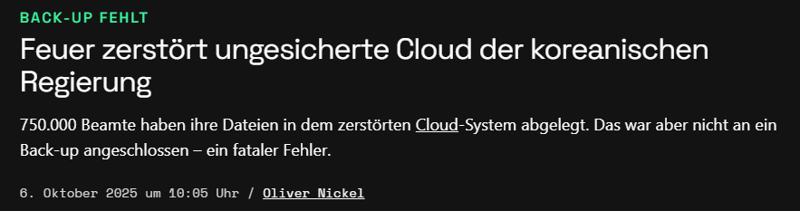

Sie haben auf Ihrem Laptop Ihre Daten für Ihre Abschlussarbeit aufbereitet, endlose Stunden in Ihre Analyse und die Verschriftlichung gesteckt. Nach vielen anstrengenden Wochen in der Universitätsbibliothek wollen Sie sich noch einen ruhigen Abend ohne Arbeit gönnen und das Ganze in Ruhe morgen in den Druck bringen. 
Dann stürzt Ihr Laptop ab - oder er wird gestohlen.

<!-- Screenshot von Beispielen  aus https://www.reddit.com/r/Studium/comments/1fs2dum/datenverlust_kurz_vor_abgabe/ oder https://www.reddit.com/r/de/comments/h8qzq4/kein_backup_kein_mitleid_oder_doch/ (Usernamen unkenntlich machen) -->

Sie wären nicht die erste Person, der so etwas passiert. Allerdings werden Sie heutzutage auf wenig Mitgefühl stossen, wenn es nach dem Slogan 

> kein Backup, kein Mitleid

geht. 

## 3-2-1 Regel

Man könnte meinen, dass das Speichern auf einer Cloud reicht - aber auch diese kann geschädigt werden - durch einen Bug oder auch ganz physisch, wie ein Fall von 2025 verdeutlicht:

Deswegen wird seit langer Zeit die 3-2-1 Regel empfohlen:

3 Kopien
2 verschiedene Speichermedien
1 dezentraler Aufbewahrungsort

<!--
Einfügen Folie "Wo speichere ich ab" aber in hübsch
-->

## Backup - Rhythmus 

Es gibt keine feste Regel, wie häufig Sie ein Backup machen sollten. Fragen Sie sich, wie viel Arbeit Sie wiederholen müssten, falls Sie nicht mehr auf die Daten zugreifen können. 

> "aktive" Hausarbeiten / Dokumente ggf. mehrfach täglich

